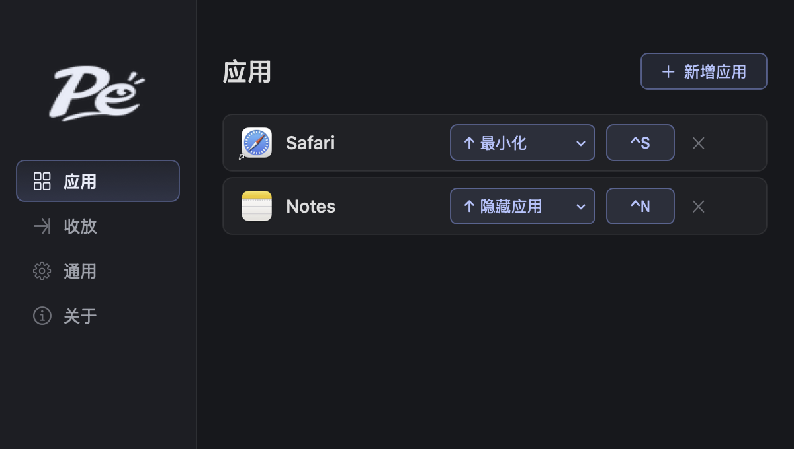
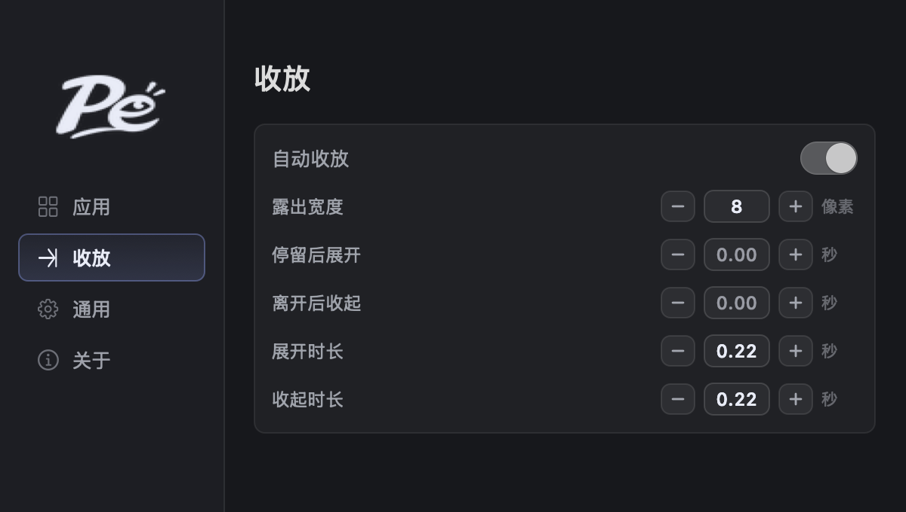
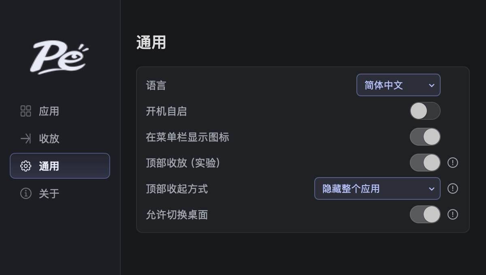

<p align="center">
  
</p>
<h1 align="center">Peek</h1>
<p align="center"><a href="README.md">简体中文</a> · <a href="README.en.md">English</a></p>
<p align="center">Hide windows you are not using. Bring them back when you need them.</p>

Peek is a lightweight window utility for macOS. Assign an application a shortcut and a screen edge to hide its window, then bring it back with the shortcut or by hovering over its edge of the screen.

- **Chinese and English**: choose 简体中文 or English in General → Language. Pages, menus, and messages update immediately.
- **A shortcut for each app**: give each application its own shortcut and hide direction.
- **Auto show and hide**: hover over the window's segment of the screen edge to show it. Move away to hide it after the hide delay. Windows sharing an edge do not all appear at once.
- **Keep a visible strip**: choose 0–100 logical pixels for the left, right, and bottom edges. The default is 8.
- **Keep window sizes**: restored windows align with the selected edge. Peek respects subsequent dragging and resizing.
- **Set your own timing**: adjust delays and movement durations, or turn off automatic behavior and use shortcuts alone.
- **Top edge (experimental)**: minimize one window or hide the entire application, then hover over its top edge segment to restore it.
- **Optional desktop switching**: recalling a window can switch to its desktop by default. Turn this off to act only on the current desktop.

## Interface

Add applications, record shortcuts, and choose hide directions:



Set automatic behavior, visible strip width, delays, and animation durations:



General contains language, launch at login, menu bar visibility, top edge hiding, and desktop switching. New configurations have top edge hiding off and desktop switching on:



*Images show the current Chinese interface. The images use example settings; General shows the enabled top-edge hiding option. Choose English in General → Language to use the English interface.*

## Installation

Requires **macOS 13 or later**. Supports Apple Silicon and Intel.

1. Open **[Download the latest release](https://github.com/yinyu985/Peek/releases/latest)** and choose the installer for your Mac. You do not need the Source code downloads:
   - **Apple Silicon (M series)**: `Peek-version-arm64.dmg`
   - **Intel**: `Peek-version-x86_64.dmg`
   - To check your chip, open the Apple menu → About This Mac.
2. Open the DMG and drag **Peek** into the **Applications** folder beside it.
3. Open Peek from Applications. If macOS blocks it, follow the steps below.

Before updating, quit the old version. Then drag in the new version and choose Replace.

### First launch: macOS security prompt

Peek **has not been notarized by Apple**, so macOS may block its first launch. If you trust the download:

1. Try to open Peek, then dismiss the warning.
2. Open **System Settings → Privacy & Security** and scroll to Security.
3. Select **Open Anyway** for Peek, then authenticate and confirm as prompted.

Button names may vary between macOS versions. See [Apple's instructions](https://support.apple.com/guide/mac-help/mh40616/mac).

If a download quarantine flag still prevents launch, and you trust this copy, you can remove the flag from **Peek** alone:

```sh
xattr -dr com.apple.quarantine "/Applications/Peek.app"
open "/Applications/Peek.app"
```

If Peek is installed in your home folder, use `"$HOME/Applications/Peek.app"` instead. These commands affect only Peek; they do not disable system-wide security checks.

### Grant Accessibility access

Follow Peek's prompt to **System Settings → Privacy & Security → Accessibility** and enable Peek. This permission lets Peek move and focus the application windows you add.

## Getting started

1. Open Apps and select Add app. The target application must be running with a standard window open.
2. Record a shortcut and choose a direction. **Start with Left or Right**; the top edge is an optional experiment.
3. Press the shortcut to bring the window forward. Press it again while the window is in front to hide it.
4. In Behavior, adjust Visible strip and the four timing settings. The strip is measured in macOS logical pixels (pt) and applies on the next hide. Zero keeps a minimal 1pt edge to reduce the chance of macOS pulling the window back. Both trigger delays default to zero seconds.

### Top edge (experimental)

Enable **Top edge (experimental)** in General to make Top available in application direction menus. Choose one of two modes:

- **Minimize window (default)**: minimize only the bound window.
- **Hide application**: hide all windows of that application together. Restoring brings the bound window forward and preserves its position and size.

**Use Minimize window for applications with multiple windows, such as browsers or Finder.** Click the information icon beside the method in General for details. In Apps, choose ↑ Minimize or ↑ Hide app for each application; ↑ Top follows the general default.

Hover over the screen's top edge segment corresponding to the original window width, or press its shortcut to restore it. Leaving the window and the path from the top edge hides it after the hide delay. Moving through the menu bar into the window keeps it open. No separate title bar is needed. Peek remembers each application’s successful recall method and uses it directly next time, including after a restart. WeChat uses the system reopen request directly. Show and hide delays apply to both modes; macOS controls the transitions, so Peek's show and hide durations do not apply. Changing modes restores an already hidden window using its previous mode, then uses the new mode on the next hide.

Turning it off removes Top from direction menus. Existing top bindings show Disabled and can be changed to another direction. Windows already hidden by Peek can still be restored. Peek does not automatically restore windows you minimized or applications you hid yourself. Click the exclamation mark beside the switch for details.

The red exclamation mark at the far right of an application row explains failed operations, disabled directions, or window position limits.

### Recommended: assign the target app to All Desktops

Right-click the application in the Dock and choose **Options → Assign To → All Desktops**. This usually lets you use Peek across desktops without switching first. If Assign To is missing, create another desktop in Mission Control.

This is optional. **Allow desktop switching** in General controls how windows on other desktops are recalled:

- **Off**: act only on the current desktop. Hover and shortcuts do not request a switch to another desktop.
- **On (default)**: activating the target window may ask macOS to switch to its desktop. For example, if you are on desktop 1 and the window is on desktop 2, Peek attempts to switch to desktop 2, rather than moving the window to desktop 1.

Click the **exclamation mark** beside the switch for details. Switching depends on macOS window and Mission Control behavior. If the switch does not complete, Peek stops and explains the issue without changing system settings.

### Language and general settings

Choose **简体中文** or **English** in General → Language. Pages, menus, help, and error messages update immediately, without restarting. On first launch, Peek uses Simplified Chinese if your preferred system language is Chinese; otherwise it uses English. It then follows your saved choice.

New configurations have top edge hiding off and desktop switching on. Updates preserve your existing switch choices.

General also contains launch at login and menu bar visibility. Press **⌘W** to close the main window while shortcuts and automatic behavior continue running. Click Peek's Dock icon to reopen it.

**Compatibility:** Desktop switching has been checked between ordinary desktops on a single display. Recall is not guaranteed for every application, full-screen Space, multiple displays, or Stage Manager. Exit full screen before using Peek. The bottom edge uses Visible strip, but some applications require a taller title bar to stay visible. In that case, the status explanation shows the actual exposed height.
