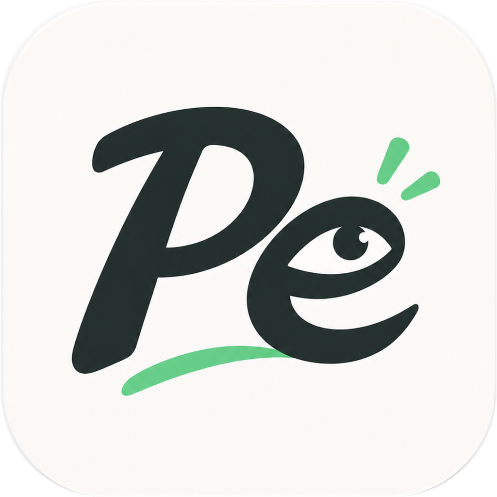
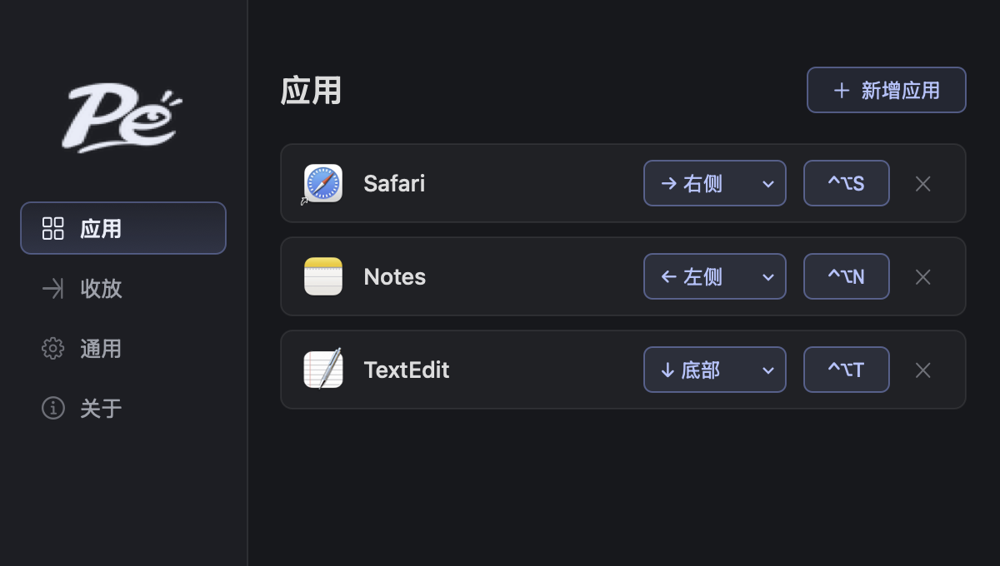
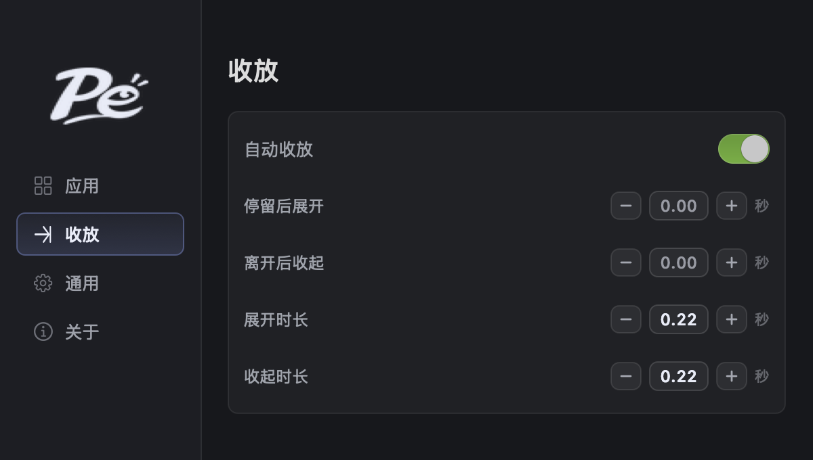

<p align="center">
  
</p>
<h1 align="center">Peek</h1>
<p align="center">把暂时不用的窗口收起来，需要时再叫回来。</p>

Peek 是一个轻量的 macOS 窗口收放工具。为应用设置快捷键和收起方向，就能把窗口藏到屏幕边缘，再通过快捷键或鼠标悬停展开。

- **一键收放**：每个应用使用自己的快捷键和方向，不必反复找窗口。
- **自动收放**：鼠标移到对应屏幕边缘时展开，进入窗口再离开后收起。
- **保留窗口大小**：展开时贴齐所选边缘，尊重你之后的拖拽和缩放。
- **按自己的节奏使用**：分别调整触发延迟和动画时长，也可以关闭自动收放，只用快捷键。

## 界面

添加应用、录制快捷键、选择收起方向：



统一设置自动收放、停留与离开延迟、展开与收起时长：



*图片由当前应用界面渲染，应用列表为示例配置。*

## 安装

需要 **macOS 13 或更新版本**，支持 Apple Silicon 和 Intel。

1. 打开 **[下载最新版](https://github.com/yinyu985/Peek/releases/latest)**，按 Mac 芯片选择安装包，不用下载 Source code：
   - **Apple Silicon（M 系列）**：`Peek-版本号-arm64.dmg`
   - **Intel**：`Peek-版本号-x86_64.dmg`
   - 不确定芯片类型时，查看苹果菜单 → 关于本机。
2. 双击打开 DMG，将 **Peek** 拖到旁边的 **Applications（应用程序）** 文件夹。
3. 从“应用程序”打开 Peek；如果被 macOS 拦截，按下面的步骤放行。

更新前请先退出旧版本，再拖入新版本并选择替换。

### 首次打开：macOS 安全提示

Peek **尚未经过 Apple 公证**，首次打开可能被 macOS 拦截。确认文件来源可信后：

1. 先尝试打开 Peek，关闭弹出的拦截提示。
2. 打开 **系统设置 → 隐私与安全性**，向下找到“安全性”。
3. 在 Peek 的拦截提示旁点击 **“仍要打开”**，按提示验证身份并确认打开。

不同 macOS 版本的按钮名称可能略有区别，参见 [Apple 的说明](https://support.apple.com/zh-cn/guide/mac-help/mh40616/mac)。

如果仍因下载隔离标记而无法打开，且你已确认来源可信，可以只移除 **Peek** 的隔离标记：

```sh
xattr -dr com.apple.quarantine "/Applications/Peek.app"
open "/Applications/Peek.app"
```

如果安装在个人目录，将路径换成 `"$HOME/Applications/Peek.app"`。命令只针对 Peek，不关闭系统全局安全检查。

### 授予辅助功能权限

首次使用时，按 Peek 的提示前往 **系统设置 → 隐私与安全性 → 辅助功能**，启用 Peek。这个权限用于移动和聚焦你添加的应用窗口。

## 开始使用

1. 打开“应用”页，点击“新增应用”。目标应用需要已运行并打开普通窗口。
2. 录制快捷键，选择顶部、底部、左侧或右侧。
3. 按快捷键唤回窗口；窗口已在前台时，再按一次收起。
4. 在“收放”页开启自动收放，或调整四项时间。两项触发延迟默认均为 0 秒。

“通用”中可以设置开机自启和菜单栏图标。按 **⌘W** 可关闭主窗口，快捷键与自动收放仍继续工作；点击 Dock 图标可重新打开。

**兼容性说明：** 顶部目前通过隐藏单窗口应用实现，不是向上滑出；底部可能保留一条窄标题栏。多显示器、多桌面和不同应用的兼容性尚未全面验证。
